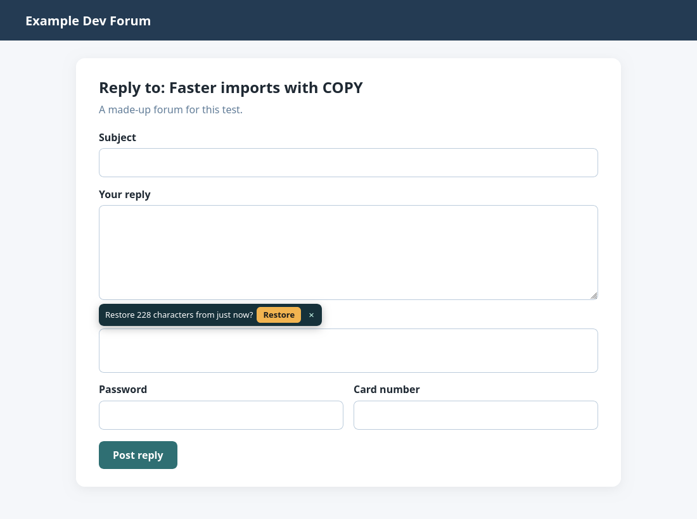

# Zapazka Lite

Free Firefox extension by [PN Scripts](https://pnscripts.com): keeps what you type in text boxes, so a
crashed browser, a closed tab or an expired session cannot take a long reply with it. Come back to the
empty box and press **Restore**, or put the text back from the toolbar button.



- Keeps `<textarea>` boxes as you type, in this Firefox profile only, for 7 days.
- Never keeps password, card, security-code or one-time-code fields, fields named for tokens, PINs or
  secrets, hidden, disabled or read-only fields, or anything in private windows.
- Sends nothing anywhere; no server, no analytics. Data collection declared to Mozilla: none.
- English and Bulgarian, following Firefox's language.

## Lite and full edition

Zapazka Lite is complete for text boxes. The paid edition,
[Zapazka](https://pnscripts.com/marketplace/firefox-zapazka), also keeps rich editors (webmail, forums,
wikis) and longer one-line fields, keeps up to 50 versions per field so an accidental delete can be
undone, and has a searchable page of every kept text with settings for days, length, excluded sites,
pause, export and delete all.

## Development

```
npm ci             # Mozilla's addons-linter
make test          # 8 Node tests
make lint          # addons-linter: 0 errors, 0 warnings
make firefox       # the flow in a real headless Firefox (8 steps)
make release       # dist/zapazka-lite-1.0.0.zip for Firefox Add-ons
```

Firefox 142 or newer. Tested in headless Firefox 156 through WebDriver BiDi; not yet on Firefox for
Android. MIT licence. Made by PN Scripts (office@pnscripts.com); created with AI assistance and
checked with automated tests.
